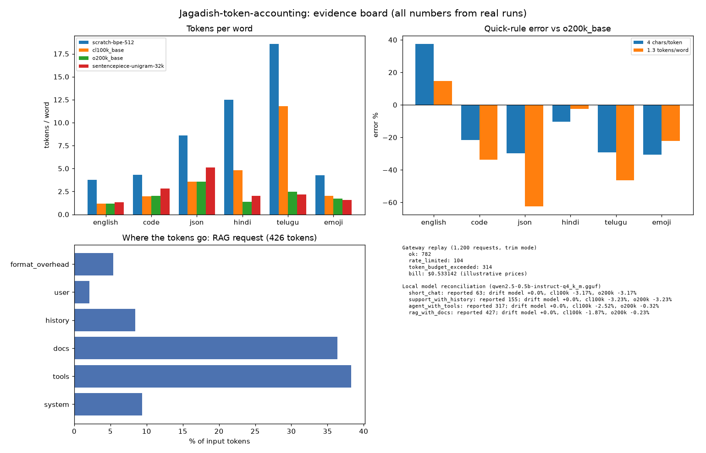
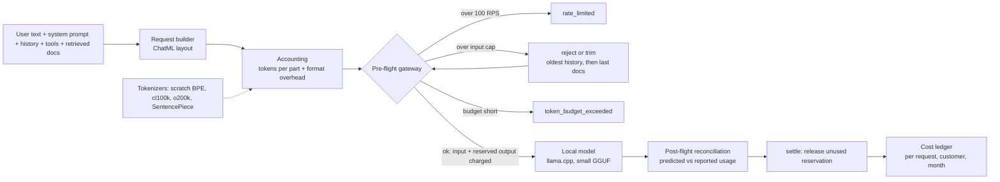

# Jagadish-token-accounting

**Recruiter summary.** Teams budget LLM features by counting words or requests, then get surprised by the bill. This repo counts tokens properly, end to end: a byte-level BPE tokenizer written from scratch, compared with real open tokenizers (tiktoken `cl100k_base` and `o200k_base`, plus a downloaded SentencePiece unigram model); full accounting of every part of a request; a pre-flight gateway that enforces an input cap, an output reservation and per-customer token budgets on top of a 100 RPS limit; reconciliation against the usage a real local model reports; and a cost ledger. Headline numbers from real runs: counting with the model's own tokenizer plus the chat template matched the local model's reported prompt tokens **exactly (0.0% drift) on all 4 requests**, while counting only the user's text missed **87-98%** of the prompt. The "4 characters per token" rule was off by **+38% on English and -30% on JSON** against `o200k_base`. 140 tests, all free and local.

Related: [Jagadish-llm-capacity-planning](https://github.com/jagadishmazure-jpg/Jagadish-llm-capacity-planning) plans capacity and cost from tokens per second; this repo is the counting layer underneath it.



## Purpose and who it is for

For engineers who put an LLM behind an API and need to know, before the call, how many tokens a request will use and what it will cost, and after the call, whether the count was right. Also for interview preparation on tokenization, prompt budgeting and cost control. See [docs/purpose.md](docs/purpose.md).

## Architecture



More detail in [docs/architecture.md](docs/architecture.md); step by step in [docs/how-it-works.md](docs/how-it-works.md).

## Results (real runs)

<!-- RESULTS:START -->
Tests: **140** (printed by `python scripts/count_tests.py`)

### Tokens per word (tokens per character in brackets)

| tokenizer | english | code | json | hindi | telugu | emoji |
|---|---|---|---|---|---|---|
| scratch-bpe-512 | 3.766 (0.599) | 4.305 (0.696) | 8.591 (0.88) | 12.5 (2.599) | 18.552 (2.69) | 4.286 (0.922) |
| cl100k_base | 1.181 (0.188) | 1.989 (0.321) | 3.545 (0.363) | 4.798 (0.998) | 11.81 (1.712) | 2.032 (0.437) |
| o200k_base | 1.16 (0.184) | 2.0 (0.323) | 3.545 (0.363) | 1.369 (0.285) | 2.483 (0.36) | 1.714 (0.369) |
| sentencepiece-unigram-32k | 1.319 (0.21) | 2.842 (0.459) | 5.136 (0.526) | 2.024 (0.421) | 2.155 (0.312) | 1.587 (0.341) |

SentencePiece unknown-piece share by type (%): english 0.0, code 3.7, json 6.5, hindi 49.4, telugu 46.4, emoji 23.0

### Where the input tokens go (o200k_base)

| request | total | system | tools | docs | history | user | format overhead |
|---|---|---|---|---|---|---|---|
| short_chat | 61 | 65.57% | 0.0% | 0.0% | 0.0% | 13.11% | 21.31% |
| support_with_history | 150 | 26.67% | 0.0% | 0.0% | 44.0% | 7.33% | 22.0% |
| agent_with_tools | 316 | 12.66% | 51.58% | 0.0% | 20.89% | 4.43% | 10.44% |
| rag_with_docs | 426 | 9.39% | 38.26% | 36.38% | 8.45% | 2.11% | 5.4% |

### Local model reconciliation (qwen2.5-0.5b-instruct-q4_k_m.gguf, prompt tokens)

| request | reported | own tokenizer + template | cl100k + template | o200k + template | content only, no framing | user text only |
|---|---|---|---|---|---|---|
| short_chat | 63 | +0.0% | -3.17% | -3.17% | -20.63% | -87.3% |
| support_with_history | 155 | +0.0% | -3.23% | -3.23% | -21.29% | -92.9% |
| agent_with_tools | 317 | +0.0% | -2.52% | -0.32% | -10.41% | -94.64% |
| rag_with_docs | 427 | +0.0% | -1.87% | -0.23% | -5.39% | -97.89% |

### Quick-rule error (signed %, estimate vs real count)

| tokenizer | rule | english | code | json | hindi | telugu | emoji |
|---|---|---|---|---|---|---|---|
| cl100k_base | 4 chars/token | +35.1 | -21.2 | -29.9 | -74.4 | -85.1 | -41.4 |
| cl100k_base | 1.3 tokens/word | +12.6 | -33.3 | -62.4 | -72.2 | -88.8 | -34.4 |
| o200k_base | 4 chars/token | +37.6 | -21.6 | -29.9 | -10.4 | -29.2 | -30.6 |
| o200k_base | 1.3 tokens/word | +14.7 | -33.7 | -62.4 | -2.6 | -46.5 | -22.2 |
| sentencepiece-unigram-32k | 4 chars/token | +21.0 | -44.8 | -51.6 | -39.4 | -18.4 | -25.0 |
| sentencepiece-unigram-32k | 1.3 tokens/word | +0.8 | -53.3 | -74.0 | -34.1 | -38.4 | -16.0 |

### Gateway and ledger replay (1,200 requests at ~110 RPS, per-customer budget 150,000 tokens; output lengths simulated)

| mode | outcomes | trimmed | bill (illustrative prices) | input / output cost |
|---|---|---|---|---|
| trim | ok 782, rate_limited 104, token_budget_exceeded 314 | 3 | $0.533142 | $0.182874 / $0.350268 |
| reject | input_over_cap 3, ok 835, rate_limited 104, token_budget_exceeded 258 | 0 | $0.548636 | $0.175085 / $0.373551 |
<!-- RESULTS:END -->

Charts: [tokens per word](docs/charts/tokens_per_word.png), [quick-rule error](docs/charts/estimate_error.png).

## How to run

```bash
python -m venv .venv && . .venv/bin/activate
pip install -e ".[dev,charts]"
pytest -q && python scripts/count_tests.py
tokacct demo                     # where the tokens go in a RAG request
tokacct bench --check results.json
# optional, fully local: SentencePiece model and a small GGUF chat model (see docs/running.md)
tokacct bench && tokacct reconcile && tokacct chart && python scripts/render_docs.py
```

## Docs

| Topic | File |
|---|---|
| Purpose | [docs/purpose.md](docs/purpose.md) |
| Architecture | [docs/architecture.md](docs/architecture.md) |
| How it works | [docs/how-it-works.md](docs/how-it-works.md) |
| Real code and output | [docs/code-and-output.md](docs/code-and-output.md) |
| Running | [docs/running.md](docs/running.md) |
| Guardrails | [docs/guardrails.md](docs/guardrails.md) |
| Limitations | [docs/limitations.md](docs/limitations.md) |
| Implementation guide | [docs/implementation-guide.md](docs/implementation-guide.md) |
| Interview points | [docs/interview-points.md](docs/interview-points.md) |
| Threat model | [docs/threat-model.md](docs/threat-model.md) |
| Decisions | [docs/adr/](docs/adr/) |
| Generated results | [docs/results.md](docs/results.md) |

## Built vs planned

| Item | Status |
|---|---|
| Byte-level BPE from scratch (train, encode, decode, round-trip on all scripts) | Built |
| cl100k_base and o200k_base comparison | Built, runs in CI |
| SentencePiece comparison (downloaded open T5 unigram model, 32k vocab) | Built; measured locally, CI tests the adapter with a tiny model trained in the test |
| Full request accounting with per-message format overhead | Built |
| Pre-flight gateway: 100 RPS, input cap (reject / trim), output reservation, per-customer budgets, settle | Built |
| Post-flight reconciliation against a real local model (llama.cpp, 0.5B GGUF) | Built; run locally, results committed, not run in CI |
| Cost ledger (Decimal, per request / customer / month, negative inputs rejected) | Built |
| Quick-rule error by content type with chart | Built |
| Gateway replay output lengths | Simulated (labelled) |
| Tokenizer for a paid hosted model, reconciliation against a hosted API | Planned, not done (free and local only) |
| Streaming responses that are cut off mid-way, partial settlement | Planned |
| Persistent budget store shared across gateway replicas | Planned (see the capacity-planning and backend repos) |

## Licence

MIT. Security reports: see [SECURITY.md](SECURITY.md).
