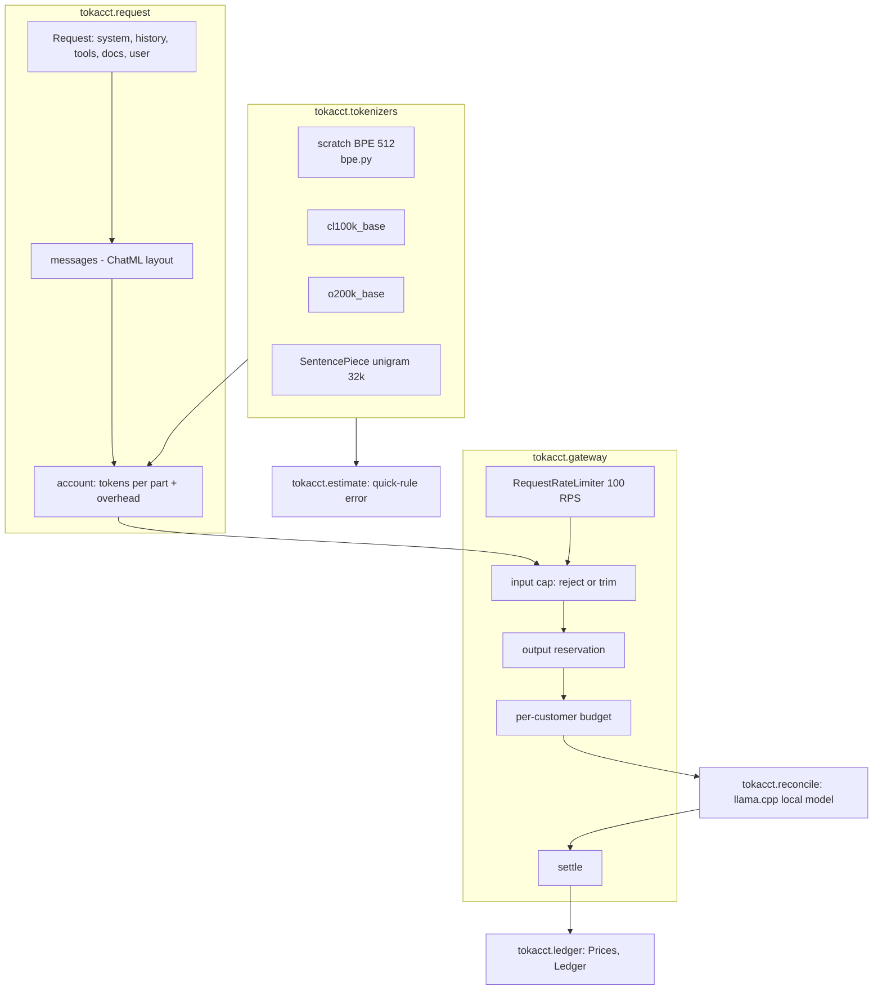

# Architecture

| Module | Job |
|---|---|
| `bpe.py` | Byte-level BPE: pre-split regex, pair counting, merges, encode, decode |
| `tokenizers.py` | One `Counter(name, count)` interface over every tokenizer; optional ones load only if installed |
| `corpus.py` | 30 evaluation samples in six content types, plus separate BPE training text |
| `compare.py` | Tokens per word and per character by type |
| `request.py` | Builds the exact messages sent and books every token to a part |
| `ratelimit.py`, `gateway.py` | Pre-flight checks, reservations and settlement |
| `reconcile.py` | Calls the local model and compares predicted with reported usage |
| `ledger.py` | Decimal cost per request, per customer and per month |
| `estimate.py` | Error of the 4-characters and 1.3-words rules |
| `replay.py` | Deterministic 1,200-request run through gateway and ledger |
| `charts.py`, `cli.py` | Charts, evidence board and the `tokacct` command |

Design choices are recorded in [adr/](adr/).
